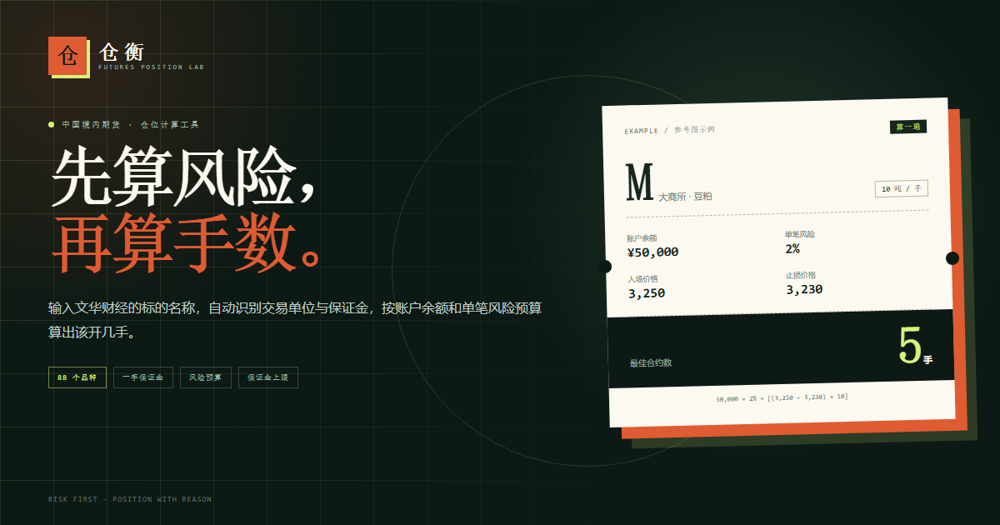

# 仓衡 · 期货仓位计算器

输入文华财经里的期货标的名称或代码，自动匹配交易单位，计算一手合约价值、一手保证金，并按固定比例风险法给出可交易手数。

**线上地址：** <https://hahaclaw.github.io/cangheng-futures-position-calculator/>



## 功能

- **88 个境内期货品种**：上期所、大商所、郑商所、中金所、上期能源、广期所。
- **智能匹配**：支持中文名、代码、别名、合约月份和主连后缀，如 `豆粕`、`M`、`M2601`、`豆粕主连`、`IF2601`。
- **一手成本**：自动显示交易单位、合约乘数、合约价值与一手保证金，保证金率可手动调整。
- **仓位计算**：按参考图的固定比例风险法计算风险手数，再叠加保证金上限，取两者较小值。
- **主连行情**：选择品种后自动尝试读取东方财富主连最新价；接口不可用时回退到手动输入。
- **可复制明细**：一键复制完整的计算参数与结果，方便记录交易计划。
- **纯静态**：没有后端、没有数据库、没有构建依赖，可直接托管到 GitHub Pages / Cloudflare Pages。

## 算法

```text
风险预算   = 账户余额 × 单笔风险比例
每手风险   = |入场价 − 止损价| × 合约乘数
风险手数   = ⌊风险预算 ÷ 每手风险⌋
保证金手数 = ⌊账户余额 ÷ 一手保证金⌋
建议手数   = min(风险手数, 保证金手数)
```

参考图示例：

```text
50,000 × 2% = 1,000
|3,250 − 3,230| × 10 = 200
1,000 ÷ 200 = 5 手
```

保证金手数上限的引入是为了避免“风险算得下、账户开不起”。页面会分别展示风险上限与保证金上限。

## 本地运行

需要 Node.js 22+。

```bash
npm test
npm run build
npm run preview
```

打开 `http://127.0.0.1:4173`。`dist/` 是可直接部署的静态产物。

## 部署到 GitHub Pages

1. 在 GitHub 创建仓库，将本目录推送到 `main` 分支。
2. 打开仓库 **Settings → Pages**，把 **Source** 设为 **GitHub Actions**。
3. 推送后，`Deploy to GitHub Pages` 工作流会自动测试、构建并发布。
4. 站点地址通常是 `https://<用户名>.github.io/<仓库名>/`。

工作流文件：`.github/workflows/deploy.yml`。

## 部署到 Cloudflare Pages（备份站）

### 方式 A：连接 GitHub 仓库（推荐）

在 Cloudflare Dashboard 中进入 **Workers & Pages → Create → Pages → Connect to Git**：

- 选择同一个 GitHub 仓库。
- Framework preset：`None`
- Build command：`npm run build`
- Build output directory：`dist`

之后每次推送都会同时更新 GitHub Pages 与 Cloudflare Pages。`dist/_headers` 会为 Cloudflare 版本附加安全响应头。

### 方式 B：命令行直接上传

```bash
npm run build
npx wrangler pages deploy dist --project-name cangheng-futures-position-calculator
```

`wrangler.toml` 已声明 `pages_build_output_dir = "dist"`。

## 目录结构

```text
src/
  index.html
  assets/
    app.js            页面交互与渲染
    calculator.js     纯仓位计算逻辑
    instruments.js    88 个品种的合约参数
    quotes.js         东方财富主连行情 JSONP
    styles.css
  _headers            Cloudflare Pages 安全头
scripts/
  build.mjs           复制静态资源到 dist
  serve.mjs           本地静态预览
tests/
  calculator.test.mjs
  instruments.test.mjs
.github/workflows/
  deploy.yml
wrangler.toml
```

## 数据说明

- 合约单位、报价单位、最小变动价位依据交易所合约规则整理。
- 参考保证金率取公开期货公司保证金公示口径（数据基准日 **2026-10-12**），通常高于交易所最低标准，且会随行情、合约月份和期货公司政策变化。
- 页面允许手动修改保证金率；实际交易前请以开户期货公司的实时标准为准。
- 手续费、滑点、交割规则未计入。
- 本项目是仓位规划工具，不构成投资建议。期货交易有杠杆，可能损失全部本金。
